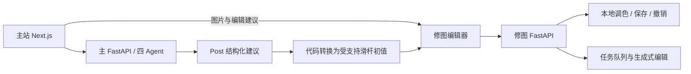

# PhotoAI：摄影 Multi-Agent 工作台

集摄影分析、拍摄规划、素材管理、学习反馈与 AI 修图于一体的摄影工作台。

当前集成版已扩展原有四 Agent 系统，加入 Post 建议到调色滑杆的转换、原图导入、生成式局部编辑接入、人物选区保护和可重复评测。

## 主要功能

- **照片分析与学习反馈**：Post 给出后期方向，Coach 提供拍摄改进建议与练习任务。
- **拍摄规划与素材管理**：支持规划、素材整理及任务历史恢复。
- **建议驱动的调色**：将受支持的结构化参数转换为滑杆初值，预览、微调后应用；不支持项明确跳过。
- **照片编辑**：局部选区、生成式修改、保存、导出和撤销；人物编辑保留原图并要求确认局部选区。
- **可重复评测**：记录原建议、转换值、实际入参及跳过原因，复盘方向反转和擅自替代等问题。

## 体验方式

**浏览器演示**：保留原产品页面和修图编辑器，使用预置三花猫案例串起 Post / Coach 分析、调色微调、圆润效果对比、素材保存与摄影练习；另提供杭州西湖一日摄影规划。分析和生成结果为预置示例，本地调色与图片导出可以实际操作。详见[前端演示与 Netlify 部署](docs/frontend-demo.md)。

**完整系统**：运行后端后，可上传自己的照片并使用真实 Agent 与生成式编辑。

本地启动说明见下方文档。建议按以下顺序体验：

1. 上传一张用于演示的照片，填写风格偏好并运行 Post / Coach 分析。
2. 查看后期建议与学习反馈，将照片送入修图工作台。
3. 预览已载入的调色初值，自行微调，点击应用，验证撤销和导出。
4. 模型额度可用时，确认局部选区与执行计划，再体验生成式编辑。

生成式编辑依赖模型额度；不具备额度时仍可体验已配置的本地滑杆调色流程。

## 项目架构

| 模块 | 技术与职责 |
| --- | --- |
| 主站 | Next.js / React：分析、规划、素材、学习与历史页面 |
| 主后端 | FastAPI：Post、Coach、Plan、Asset 四 Agent 编排，媒体和结果管理 |
| 分析与修图衔接 | 导出原图、读取 Post 结果、转换受支持的调色参数，并传递到编辑器 |
| 修图编辑 | Vite / React 编辑界面、FastAPI API、ARQ worker、PostgreSQL、Redis、MinIO |
| 模型 | 主 Agent 当前使用 DeepSeek Anthropic 兼容接口；修图规划和图像编辑接阿里云百炼 |



各模块组成完整的摄影工作流：分析照片、生成建议、预览微调、执行编辑和导出结果。主 API 与修图 API 分进程运行，部署时通过同一个 HTTPS 入口提供访问。

## 关键文档

- [纯前端演示：案例、体验与 Netlify 部署](docs/frontend-demo.md)
- [完整演示部署包与资源清单](deploy/full-demo/README.md)
- [修图服务集成说明](docs/retouch-integration.md)
- [Post 建议 → 调色滑杆](docs/post-to-sliders.md)
- [人物笔刷与选区保护](docs/portrait-brush-improvements.md)
- [第一条可重复评测：阴影方向与不支持参数替代](evaluations/001-shadow-direction/README.md)

## 当前验证边界

已验证本地主要接口、参数转换、选区操作、保存与撤销，以及前端生产构建。基本调色不需要调用规划模型；生成式修改仍取决于图片模型的权限、额度、延迟和质量。

参数幅度是明确标记的近似初值，不宣称等同于 Lightroom。简化抠图不会自动用于人物编辑；人物结果仍需人工检查。主站目前是共享演示数据环境，不宣称已经实现完整 SaaS 多用户隔离。

## 本地与发布

主后端依赖见 `requirements.txt`，主前端位于 `frontend/`。修图服务按相关文档初始化，各服务的启动方式与运行依赖见部署说明。

主系统测试与修图测试分进程执行，避免两个后端同名 `app` 包互相干扰：

```powershell
python -m pytest
# 在修图专用 Python 环境中运行（本地初始化后）：
.\.test_artifacts\retouch-runtime\Scripts\python.exe -m unittest discover -s tests -p 'test_retouch*.py' -q
```

初始化修图依赖之前，可先运行主系统测试。修图测试检查适配代码，需先取得固定版本并应用补丁。

模型 Key 仅在后端环境配置。发布范围排除本地密钥、数据库、上传照片、私人档案、测试产物与运行缓存。
