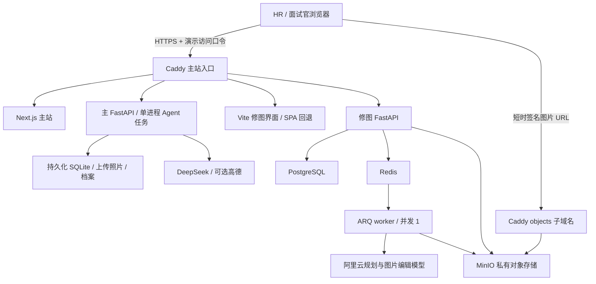

# PhotoAI 求职演示版：真实分析与在线修图部署包

**当前交付是部署文件和资源清单，还没有购买服务器、注册域名或发布公网网址。**

本项目实际为 Next.js 16 / React 19 主站、Python FastAPI 主接口、独立 Vite 修图界面及 FastAPI API/ARQ worker、PostgreSQL、Redis、MinIO。主 Agent 当前接 DeepSeek Anthropic 兼容接口；修图规划及图片编辑使用阿里云百炼。不是只部署一个静态页面，也不是默认使用 Claude。

## 需要准备的资源

| 资源 | 首版建议 | 用途 |
| --- | --- | --- |
| 1 台 Linux 云服务器 | 建议 4 vCPU、8 GB RAM、80 GB SSD，Ubuntu 24.04 LTS x86_64 | 低并发演示、构建和大图处理；这是工程估算，不是压测结论 |
| 固定公网 IPv4 | 1 个 | DNS 和 HTTPS 入口 |
| 一个自己可管理 DNS 的域名 | 两条 A 记录：`demo.你的域名`、`objects.你的域名`，都指向服务器 | 主站与私有图片签名链接 |
| Docker Engine + Compose v2 | 服务器安装 | 运行服务并持久化数据 |
| DeepSeek 与百炼 API 额度 | 独立演示 Key，后台配置 | 真实分析、规划和生成式编辑 |
| 可选高德 Web 服务 Key | 检查实际天气、POI 配额 | 拍摄规划中的外部信息 |
| 邮箱、服务器磁盘快照/备份能力 | 有效邮箱；定期备份 | 证书通知与数据恢复 |

先购买短周期、可升降配的资源，购买时核对控制台实际报价、续费价、带宽及流量包；本文件不提供未经核实的促销价格。不需要本地 GPU，模型计算走云 API。2 vCPU/4 GB 可以作为低并发试跑候选，但不建议同时进行镜像构建和大图任务。

选区能访问所用模型 API、GitHub 和软件镜像源的服务器区域；在正式迁移前实际验证连通性。一个 29.6 MB 的结果图会产生真实存储和下载流量，别只比较 CPU 月费。

## 部署结构



只有 Caddy 发布 80/443 端口。数据库、Redis、MinIO 控制台、主 API 与修图 API 均不直接发布主机端口。主站与 iframe 同源，修图登录 Cookie 在 HTTPS 下工作。图片域名仅代理 GET/HEAD/OPTIONS，桶保持私有。

路由保留：主 API 为 `/api/jobs`、`/api/media`、`/api/agents` 等；修图 API 为 `/api/auth`、`/api/assets`、`/api/sessions`、`/api/runs` 等。`/photoai-import`、`/editor/*`、`/auth`、`/assets/*`（静态资源）属于修图界面。现有主站 `/assets` 页面不受影响；后续若增加同名深层路由，需要同步更新 Caddy 路由。

`retouch.Dockerfile` 拉取上游固定提交并应用 `integrations/retouch-photoai.patch`，不复制本地 checkout 或私人账号数据。MinIO 复用已有官方固定源代码构建文件；首次构建会下载 Go 依赖。保留上游来源与许可证文件，不把第三方项目称为自主实现。

## 将来在服务器上的操作

以下是将来获得服务器后的命令，现在不要把示例域名直接作为真实部署地址。

1. 安装 Docker 与 Compose，设置 DNS 两条 A 记录，允许 80/443；SSH 仅允许你自己的来源。不要放开 5432、6379、9000、9001、7302、8000。
2. 上传审核后的项目代码。**当前本地还有大量未提交修改，直接 clone 远端旧仓库不会包含本次修复。** 发布前整理明确的提交/发布包；排除 `.env`、`model.env`、`media`、`.test_artifacts`、SQLite、私人档案和本地照片。根 `.dockerignore` 另行限制镜像构建上下文。
3. 在项目根目录执行：

```bash
cp deploy/full-demo/env.example deploy/full-demo/.env
chmod 600 deploy/full-demo/.env
docker run --rm -it caddy:2 caddy hash-password
```

最后一个命令交互输入**演示入口密码**，把输出的 bcrypt hash 以单引号保存到 `.env`。它与修图账号密码不同。数据库、对象存储和 JWT 各使用独立的随机值；可用 `openssl rand -hex 32` 分别生成。不要复用本地开发密码。

4. 编辑服务器 `.env`：设置真实域名、邮箱、上述随机密码、DeepSeek 与百炼 Key、模型名称和百炼业务空间 Base URL。不要把本地整份 `model.env` 上传，也不要把模型 Key 写进 `NEXT_PUBLIC_*` 或 Docker build args。

5. 检查配置，然后构建、启动：

```bash
python3 -m venv /tmp/photoai-preflight
/tmp/photoai-preflight/bin/pip install python-dotenv
/tmp/photoai-preflight/bin/python deploy/full-demo/preflight.py
docker compose --env-file deploy/full-demo/.env -f deploy/full-demo/compose.yaml config --quiet
docker compose --env-file deploy/full-demo/.env -f deploy/full-demo/compose.yaml build
docker compose --env-file deploy/full-demo/.env -f deploy/full-demo/compose.yaml up -d
docker compose --env-file deploy/full-demo/.env -f deploy/full-demo/compose.yaml ps
```

迁移服务先完成 PostgreSQL schema，再启动修图 API，API 健康后启动 worker。不要启动多个主 API worker：当前主 Agent 的任务与事件总线仍在进程内。修图默认每次处理一个任务，以减少大图并发内存压力。

修改域名后必须重建主站和修图前端：`NEXT_PUBLIC_*` 与 `VITE_*` 在构建时写入浏览器代码，仅重启容器不会替换它们。代理统一保留 SSE 流式响应。

## 访问与成本边界

- 主站使用演示入口口令保护，不是开放匿名注册、无限调用的公共 SaaS。给 HR 分享网址时，另附入口用户名/密码和体验步骤。
- 首次进入修图仍需要创建/登录独立修图账号。主站目前的历史、素材、学习档案是共享演示环境，**未实现完整多用户隔离**。只放授权演示照片，告知访客不要上传私人或保密素材。
- 两个 API 共用持久化的每日 POST 次数表，默认合计 60 次，按 UTC 日期重置。鉴权、上传、笔刷选区操作及 GET/SSE 不计入；会话创建、本地调色及失败尝试也可能计入。这是保守的**入口操作次数限制，不等于 60 次模型调用或金额预算**。
- 限额数据库不可用时拒绝新操作，不默默放行付费请求。入口口令外泄后应更换；模型侧仍应设置可用的费用预警、支出限制及可撤销的演示专用 Key。
- 免费额度用完即停、欠费或模型权限问题不会被部署消除。上线前分别测试分析模型、规划模型及图片编辑模型。
- 现有简化抠图不作为可靠人物分割发布，自动拆层保护仍保留。`MATTING_PROVIDER=corner`、`OCR_PROVIDER=none` 与当前验证模式一致：笔刷、滑杆、生成式局部编辑可走现有流程，但点选是简化选区，不宣称完整智能抠图能力。

## 数据、备份与回滚

命名卷分别保存主站 SQLite/照片/档案、PostgreSQL、Redis、对象图片、请求次数及证书。容器重建不会清空这些卷。主站的演示历史需定期清理；此包未加入自动清理私人照片的后台任务。

第一次对外演示前做一次数据库与对象存储恢复演练。简单的低并发 Demo 可在停服务后做整盘一致快照；运行中需分别使用 SQLite backup API、PostgreSQL dump 和对象存储备份。仅备份代码不能恢复照片。

更新前保存旧镜像标识和数据备份；执行过数据库迁移后，回滚镜像之前检查 schema 是否兼容。不要用 `docker compose down -v` 当作普通重启，它会删除命名卷数据。

## 上线验收，仍待云服务器具备后执行

1. 非本机网络打开 HTTPS 主站，入口口令有效；未登录无法访问模型 API。
2. 页面网络请求不包含访客电脑的 localhost，证书正常。
3. 上传演示照片，Post/Coach 分析完成，SSE 进度正常，刷新能恢复历史。
4. 打开修图 iframe、注册/登录，刷新 `/editor/会话ID` 能加载，图片签名链接可用于画布。
5. 导入 Post 建议，预览微调、应用保存、导出和撤销；包含超过 20 MiB 的内部 PNG。
6. 在已确认额度条件下测试一次小范围生成式编辑，不自动对私人照片付费重跑。
7. 验证请求次数上限、容器重启后数据保留、备份恢复，再生成给 HR 的体验说明。

## 本次已做与未做

已完成：Compose 配置解析、官方 Caddy 镜像中的代理配置验证、主站 standalone 生产构建、5 条部署前环境校验与并发请求限额测试。示例占位符会被 preflight 阻止，避免把模板误当真实配置。配置不读取本地密钥，根构建上下文排除私人运行数据。

尚未完成：云资源开通、DNS/TLS 实网验证、所有 Linux Docker 镜像构建、全栈云端冷启动、生产存储及多人负载测试。基础镜像和部分传递依赖尚未完全锁定 digest/版本，真实上线前应以验证后的镜像保存发布版本。

参考：[Docker Compose 生产部署](https://docs.docker.com/compose/how-tos/production/)、[Caddy Basic Auth](https://caddyserver.com/docs/caddyfile/directives/basic_auth)、[Caddy 流式代理](https://caddyserver.com/docs/caddyfile/directives/reverse_proxy)。Next.js 依据本地安装版本的 self-hosting 和 standalone 文档配置。
